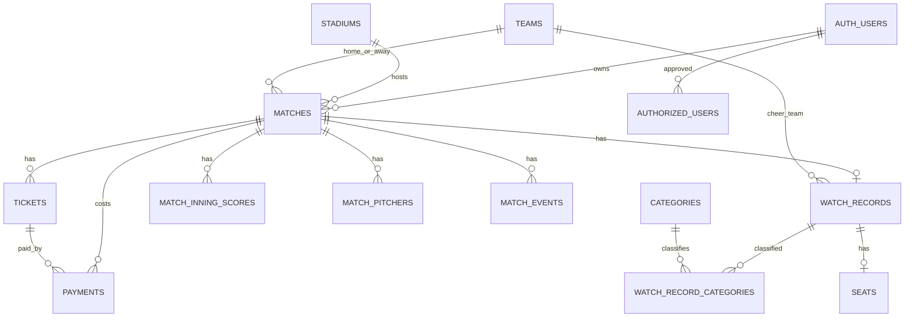

# new-game-log Supabaseスキーマ設計

## 調査結果

現行アプリはReactの`BaseballContext`で`MatchRecord[]`を保持し、`localStorage`へJSON保存しています。Supabase関連コードは設定URLとanon keyを保存するだけで、認証・同期・CRUDは未実装です。[baseball.ts](/Users/fujiwara.h/Desktop/new-game-log/src/types/baseball.ts)の型と以下の画面を基準に設計しました。

- 試合・観戦登録／編集: `RecordFormModal`
- 詳細表示・削除: `RecordDetail`
- ダッシュボード: `HomeDashboard`
- 統計: `StatsDashboard`
- 観戦予定・チケット: `ScheduleTickets`
- バックアップ・Excel入出力・設定: `SettingsMaster`

`INITIAL_SEED_RECORDS`はデモ表示用であり、SQLからは投入しません。リポジトリ内のExcelは将来移行の参考資料として扱い、SQLには実データを含めていません。

### 実装済みと未実装

実装済み: 試合基本情報、スコア、延長を含むイニング配列、カテゴリ複数選択、主カテゴリ、観戦状態・応援チーム、座席、同行者・メモ、チケット状態、費用概要、分割支払いUI、本塁打・投手、予定カレンダー、統計、JSON/CSV/Excel入出力、localStorage保存。

未実装: Supabase Auth、Supabaseへの同期、DB CRUD、DBマスター編集の永続化、チケットを1試合に複数持つUI、支払い明細を独立エンティティとして編集するUI。今回のDBは後者の要件を保存できるようにし、UI移行は別作業とします。

## TypeScript型との対応

| 現行型 | DB | 備考 |
|---|---|---|
| `MatchRecord.id` | `matches.id uuid` | 現行の`rec_...`/`excel_...`は`legacy_id`または`import_rows`に保持 |
| `date`, `isDateUnknown`, `time` | `matches.match_date`, `date_unknown`, `start_time` | 未定はNULL + `date_unknown=true`。同日重複制約は設けない |
| `homeTeamId`, `awayTeamId` | `matches.home_team_id`, `away_team_id` | `teams.id`参照 |
| `stadiumId`, `stadiumCustom` | `matches.stadium_id`, `stadium_custom_name` | マスター外名称を保持可能 |
| `matchType`, `matchStatus` | `matches.match_type`, `match_status` | `postponed`をDBで追加。現行TSのunionにも追加が必要 |
| `homeScore`, `awayScore`, `isScoreConfirmed` | `matches.home_score`, `away_score`, `score_confirmed` | NULLと0を区別。確定時は両スコア必須 |
| `innings` | `match_inning_scores`, `match_team_totals` | 1行/試合・イニング・表裏。未入力runsはNULL |
| `pitchers` | `match_pitchers` | role/sideで先発・勝利・敗戦・セーブを表現 |
| `homeRuns`, `events`, `links` | `match_events`, `match_links` | 本塁打は`event_type='home_run'` |
| `watchStatus`, `cheerTeamId` | `watch_records.watch_status`, `cheer_team_id` | 初期応援チームはseed済みのteam id `dragons`を設定 |
| `categories`, `primaryCategory` | `watch_record_categories` | 複数行。`is_primary`の部分UNIQUEで主カテゴリは最大1つ |
| `seatInfo` | `seats` | 正規化された席種と自由入力名を併用 |
| `companions`, `watchMemo` | `watch_records` | 現行UIの文字列を保持 |
| `costInfo` | `watch_records` + `payments` | 概要額と分割明細を分離。NULLと0を区別 |
| `ticketInfo` | `tickets` | 1試合複数購入履歴 |
| `createdAt`, `updatedAt` | 各主要テーブル | `timestamptz`。更新トリガーで自動更新 |

## テーブル一覧・関係

### マスター

- `teams`: 球団・代表チーム。現行`teams.ts`の名称・識別子を初期投入。
- `categories`: 中日1軍、2軍、日本代表、その他。
- `stadiums`: 現行`stadiums.ts`にある球場名と所在地。席種属性は推測で大量投入しない。球場不明は`matches.stadium_id`と`stadium_custom_name`をともにNULLとして保存し、`other_stadium`とは区別する。
- `seat_types`: 席種の拡張用マスター。
- `stadium_seat_types`: 球場と席種の多対多関係。

### 個人データ

- `authorized_users`: Authユーザーのうち、このアプリを利用できるユーザー。利用者本人のUUIDはSQLに埋め込まない。
- `matches`: 試合そのもの。`owner_id`を持つため、同じ試合日でも複数行を登録できる。
- `watch_records`: 1試合につき最大1件の個人観戦記録。
- `watch_record_categories`: 観戦記録とカテゴリの多対多。
- `seats`: 観戦記録の座席情報。
- `tickets`: 1試合に複数のチケット購入履歴。
- `payments`: 1試合の支払い明細。チケット紐付けまたは観戦記録紐付けを必須化。
- `match_inning_scores`, `match_team_totals`: イニング別得点とR/H/E。
- `match_pitchers`, `match_events`, `match_links`: 投手、イベント、関連URL。
- `import_batches`, `import_rows`: Excel等の原本・シート・行番号・raw JSONと重複判定結果を保持。

## NULL・制約・集計

- 日付不明は`match_date NULL`と`date_unknown=true`。日付不明を架空の日付へ変換しない。
- スコア未入力はNULL、0-0は0。`score_confirmed=true`の場合のみ両スコアを要求。
- 金額は`numeric(12,2)`。0は無料・無償、NULLは未入力。
- 金額・得点・枚数・試合時間は負数を拒否。
- `owner_id`ごとの`legacy_id`以外に、日付だけのUNIQUEは作らない。
- 観戦勝率は`wins / (wins + losses)`。引分・中止・予定は分母から除外。
- `dashboard_match_facts`はカテゴリを結合しないため全体集計の二重計上を避ける。応援チームがホーム／ビジターのどちらにも一致しない場合は`unknown`とし、勝率から除外する。予定・結果未入力は`scheduled`、延期は`postponed`、中止は`cancelled`、同点は`draw`。カテゴリ別集計は`category_statistics`を使い、カテゴリ所属分として明示的に集計する。
- `watch_record_costs`は概要額と支払明細合計を別列で返す。ビューは`security_invoker=true`で、基表RLSを呼び出し元に適用する。

## RLS・認可

全テーブルでRLSを有効化しています。個人テーブルは`owner_id = auth.uid()`と`current_user_is_authorized()`、子テーブルは親の所有者確認も要求します。SELECT/INSERT/UPDATE/DELETEの全操作で承認状態を確認するため、承認取り消し後は既存データも操作できません。UPDATEの`WITH CHECK`により所有者を別UUIDへ変更できません。Supabaseサービスとの互換性のためpublicスキーマのPUBLIC USAGEは維持しますが、匿名ロールにはアプリ専用テーブルの実効権限・ビュー権限を付与しません。

マスターは承認済みユーザーだけがSELECTできます。現行の個人専用運用では、承認済みユーザーが共有マスターの追加・変更・削除も行える仕様です。将来複数利用者や管理者を分離する場合は、`authorized_users`に管理者ロールを追加し、マスター管理ポリシーを管理者ロール専用へ分離します。承認テーブル自身は本人行だけSELECT可能で、一般ユーザーが自分を承認するINSERTポリシーはありません。

`set_updated_at`とimport行の所有者検証は通常のトリガー関数であり、SECURITY DEFINERを使用していません。`current_user_is_authorized`もSECURITY INVOKERです。APIロールのスキーマ使用権限は、RLS・GRANT設定完了後にauthenticatedへだけ戻します。

親子所有者は、matches/watch_records/tickets/payments/import_batchesの複合外部キーでDB制約として保証します。paymentsは`(match_id, watch_record_id, owner_id)`または`(match_id, ticket_id, owner_id)`を参照し、支払いの試合と観戦記録・チケットの試合が必ず一致します。任意の参照側がNULLの場合は複合FKが不成立にならず、`payments_target_ck`が少なくとも一方の参照を要求します。import_rowsの任意のtarget/duplicate matchは、削除時に所有者列をNULL化しないよう、通常関数のトリガーで同一所有者を検査します。RLSはさらに実行主体と親行の可視性を制限します。

## Excel移行

現時点では列仕様を確定しません。移行実装時に、`import_batches`へファイル単位、`import_rows`へシート名・行番号・原本JSONを保存し、正規化後の`matches.legacy_id`と`target_match_id`を記録します。同一利用者の既存`legacy_id`を重複検出に利用できます。カテゴリ延べ件数は`watch_record_categories`へ複数行として保持します。

## コード側の推奨修正

1. SupabaseクライアントとAuthセッションを導入し、`localStorage`を本番データ源にしない。
2. `MatchRecord.id`をDB UUIDへ切り替え、保存用の`legacy_id`をUI型から分離する。
3. `innings`・`pitchers`・`homeRuns`・`links`をDBの子行へ変換するrepository/mapperを追加する。
4. `ticketInfo`を`TicketManagement[]`へ、`costInfo.splits`を`payments[]`へ変更する。
5. `stadiumId`をnullableにし、`stadiumCustom`と共存可能にする。
6. `matchStatus`へ`postponed`を追加する。
7. 現在のカテゴリ集計は複数カテゴリのレコードをカテゴリ別には重複計上する一方、全体は重複排除する方針を明示する。
8. `selectedYear`の初期値`2026`と、デモデータを200件以上要求するlocalStorage復元条件は本番移行時に除去する。
